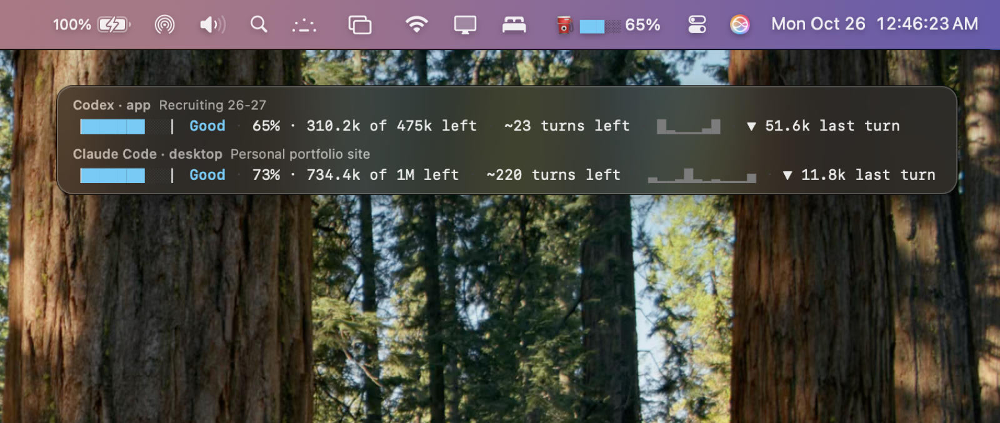
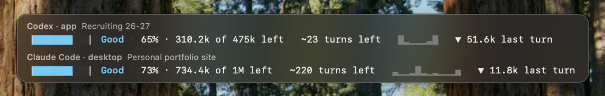
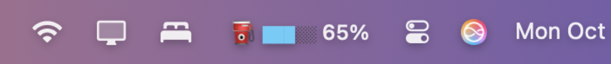

# Token Fuel

A live fuel gauge for your AI coding sessions. It shows how much of the context window is left in **Claude Code** (terminal and the Claude desktop app's Code tab) and **Codex** (CLI and the Codex app). It sits in the macOS menu bar and in an optional floating window that stays on top of every app. It reads the exact token counts each tool already writes to your Mac and never estimates.

Current version: v1.1

## Screenshots



TokenFuel in action: the menu bar item (gas pump, bar, percent left) and the floating window, live-tracking a Codex chat and a Claude Code session at the same time.



The floating window: one row per tool, with the session name, fuel level, percent and tokens left, estimated turns left, the last 12 turns and the last turn's size.



The menu bar item: the most recently active session at a glance.

## What it shows

```
▕███░░░░░░░▏ Low · 33% · 65.6k of 200k left · ~3 turns left · ▂▁▃▂▅▂▁▃▄▂▇▅ · ▼ 21.4k last turn
```

- **Fuel bar and label:** 10 cells, colored by how much is left (table below).
- **What's left:** the percentage and tokens left, out of the window size.
- **Turns left:** what's left divided by the average of your last 5 turns. It appears once a session has 2 turns.
- **Turn chart:** context used by each of the last 12 turns. A taller bar means a bigger turn.
- **Last turn:** how much the latest turn used. After `/compact`, or any big drop, it shows **⛽ Refueled** instead.

| Left | Label | Color |
|---|---|---|
| 75% or more | Full | green |
| 50-74% | Good | cyan |
| 25-49% | Low | yellow |
| 10-24% | Reserve | magenta |
| under 10% | Refuel soon | red |

**Where it shows**
- **Menu bar:** `⛽ ████░ 80%` for your most recently active session. The tooltip says which session that is.
- **Menu (click the icon):** every session active in the last 2 hours (at most 6), newest first, each with the full gauge line. Also on the menu: Show Floating Window, Launch at Login and Quit.
- **Floating window:** the newest Claude Code session and the newest Codex session, one row each. It stays on top of every app and on every desktop. Drag it anywhere and it remembers the spot. Right-click it to hide it or quit.

**How it measures (exact sources only)**
- **Claude Code:** reads `~/.claude/projects/*/*.jsonl`. Context used is the input, cache-write and cache-read tokens of the latest main-conversation reply. The window is 1M for Opus 5 models, `[1m]` models, or any session that has passed 200k; otherwise it is 200k. A turn starts with each message you send.
- **Codex:** reads `~/.codex/sessions/YYYY/MM/DD/*.jsonl`, any day folder, since a resumed chat keeps writing to its original file. Context used is Codex's own `last_token_usage.total_tokens`, and the window is Codex's own `model_context_window`. A turn starts at each `task_started` event. Sub-agent threads are skipped.
- **Updates:** it checks every 2 seconds and only re-reads files that changed. It uses about 40MB of memory and close to 0% CPU.

## Install

Requires macOS 13 or later and the Xcode command-line tools.

```
cd ~/token-fuel
./build.sh
open TokenFuel.app
```

On first launch it turns on **Launch at Login**, so it is always running. You can switch that off from the menu. If the app crashes it restarts itself. If you choose Quit, it stays off until your next login.

## Uninstall

```
pkill -x TokenFuel; rm -f ~/Library/LaunchAgents/local.token-fuel.plist; defaults delete local.token-fuel; rm -rf ~/token-fuel
```

## Product milestones

### v0.1 - Status-line gauge in Claude Code (Oct 6, 2026)
- **What changed:** A first version as a Claude Code "status line" add-on: a Node script wired into `~/.claude/settings.json`. One line showed a 10-cell fuel bar with a label and color, `% · X of Y left`, "~N turns left" (average burn of the last 5 turns), a 12-turn sparkline, "last turn" usage, and a "Refueled" notice after `/compact` or any large drop. Turns were detected from real user prompts in the session transcript, with per-session history saved to disk.
- **Why:** Running out of context is invisible until quality drops or the session compacts. A gauge makes it a planned decision.
- **Result / tradeoff:** Rich and useful, but it assumed a 200k window and only worked where Claude Code honors the status-line setting.

### v0.2 - Floating pill on the Claude desktop window
- **What changed:** A small native Swift app floated a pill-shaped gauge above the prompt box of the Claude desktop window, visible only while Claude was the front app, draggable, with a right-click Reset/Quit, and started at login. The Node script gained a streaming mode that followed the most recently active session, and the pill showed the session name.
- **Why:** The user works in the desktop app's Code tab, which ignores the status-line setting (a known gap), so v0.1 showed nothing.
- **Result / tradeoff:** The gauge finally appeared where the work happens. But it was glued to the Claude window's geometry (fragile), and the app could not tell which session was on screen, so it guessed the latest one.

### v0.2.1 - Correct context window size
- **What changed:** Window size became 1M for Opus 5 and `[1m]` models, or for any session that had ever exceeded 200k; 200k otherwise; with a config override. The pill's square shadow was also fixed to follow its rounded corners.
- **Why:** The gauge read "50% left" at about 100k tokens used because it assumed 200k, while this user's Opus 5 sessions have a 1M window (one reached about 880k). A gauge that is wrong by 5x is worse than none.
- **Result / tradeoff:** Accurate percentages for the user's real sessions, at the cost of model-specific rules that must be kept current.

### Reset - full removal
- **What changed:** Everything was uninstalled: login agent, app, script, saved state, status-line setting and notes.
- **Why:** The user decided the product should live independently of the Claude window and work across apps, not stay a patch on one app's layout.
- **Result / tradeoff:** A clean slate, and no leftover configuration on the machine.

### Feasibility review - "exact sources only"
- **What changed:** Before rebuilding, we assessed which tools could be gauged from reliable data. Claude Code (CLI and desktop Code tab) records exact per-message token counts on disk. Claude desktop chat, ChatGPT and ChatGPT Atlas keep no token counts locally; the only route is estimating by screen reading, which is fragile and needs extra permissions. Codex CLI keeps local logs and looked possibly usable.
- **Decision:** Exact sources only, delivered as a menu-bar item plus an optional floating window.
- **Result / tradeoff:** Trustworthy numbers and a smaller scope. Chat apps are out until they expose real counts.

### v1.0 - Standalone menu-bar app, first build (Oct 7, 2026)
- **What changed:** Rebuilt from scratch in pure Swift as a menu bar item plus a toggleable floating window, no longer tied to the Claude window.
- **Why:** This removed the two weak points of v0.2: depending on where the Claude window sits, and depending on a separate Node script.
- **Result / tradeoff:** A review found this build was not shippable. The menu bar icon never appeared. The floating window was a snapshot that never updated. It watched only one project folder, counted output tokens as context, and sorted sessions in the wrong order. Turn tracking, turns left, the chart, Refueled and launch at login were all missing. Codex was wrongly ruled out; its logs do contain exact token counts.

### v1.1 - Live, cross-app, always on (Oct 7, 2026)
- **What changed:**
  - **Cross-app:** Codex (CLI and the Codex app) added as a second exact source, using Codex's own token counts and window size.
  - **Live:** the floating window and the open menu now refresh every 2 seconds.
  - **Full gauge restored:** turns left, the 12-turn chart, last turn and ⛽ Refueled are back. Turns are rebuilt from each session log, so history is right even right after launch.
  - **Accurate counts:** all Claude Code project folders are watched, the context count matches Claude Code's (input side only), and sessions are ordered by when they were really last active.
  - **Visible menu bar icon:** the app places its icon near the right of the menu bar. On a notched MacBook, macOS puts new icons behind the notch, where they are hidden. That was v1.0's "invisible icon".
  - **Always on:** launch at login is on by default. The app restarts after a crash and allows only one copy at a time. The floating window is draggable and remembers its position.
- **Why:** The goal was a live gauge across apps, always on, with exact numbers only. v1.0 met none of these.
- **Result / tradeoff:**
  - **Checked against the logs:** the numbers match what each log records (for example Codex 92.6k of 354.4k used, 74% left), and a simulated session confirmed the turn and Refueled logic.
  - **Chat apps still excluded:** the Claude chat app and ChatGPT store no token counts on the Mac, so they stay out.

## Known issues

- **Following, not seeing:** the menu bar shows the most recently active session, not necessarily the one on your screen, since no app exposes which session is on screen. The session name is shown so it's clear which one you are reading.
- **Window size for Claude models is a rule:** 1M for Opus 5 and `[1m]` models, or once a session passes 200k; otherwise 200k. A non-Opus model with a 1M window reads low until it passes 200k.
- **Crowded menu bars:** if the menu bar is very full, macOS may still hide some icon (possibly this one). ⌘-drag icons to rearrange them.
- **First turn of a session:** it starts counting from the first reply, so the system prompt isn't counted as part of turn 1.
